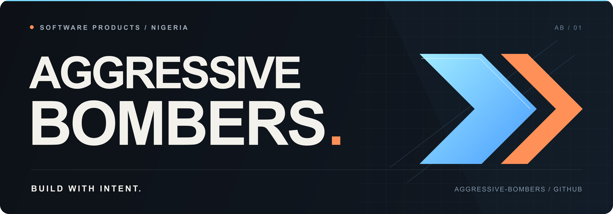

  

<h1 align="center">Software for the way Nigeria works.</h1>

  We build software products that tackle the challenges 
  businesses and institutions face in Nigeria.

  <a href="https://github.com/orgs/Aggressive-Bombers/repositories"><strong>Explore our repositories</strong></a>
  &nbsp;&nbsp;·&nbsp;&nbsp;
  <a href="#how-we-build"><strong>How we build</strong></a>

---

## Real problems. Useful products.

Good software starts with understanding the work it needs to support. At **Aggressive Bombers**, we focus on the problems behind the request: the process that takes too long, the information that is hard to find, or the tools that make everyday work harder than it should be.

Our goal is to turn those challenges into products that help people and organisations move forward.

<table>
  <tr>
    <th align="left" width="33%">For businesses</th>
    <th align="left" width="33%">For institutions</th>
    <th align="left" width="33%">Built for Nigeria</th>
  </tr>
  <tr>
    <td valign="top">Practical products that simplify operations and help teams focus on their work.</td>
    <td valign="top">Software shaped around the people, processes, and responsibilities of institutional work.</td>
    <td valign="top">Local challenges and everyday realities at the heart of the product.</td>
  </tr>
</table>

## How we build

1. **Understand the problem.** Start with the people doing the work and the challenges they face.
2. **Make it useful.** Give every feature a clear purpose and make the product easier to use.
3. **Keep improving.** Learn from real use, refine what matters, and build on what works.

## Explore the work

Our GitHub is a home for the work we share. Explore our repositories and follow the products as they take shape.

**[Browse Aggressive Bombers on GitHub](https://github.com/orgs/Aggressive-Bombers/repositories)**

---

  <strong>Built with intent. Built for real work.</strong> 
  Aggressive Bombers · Software for businesses and institutions in Nigeria.

